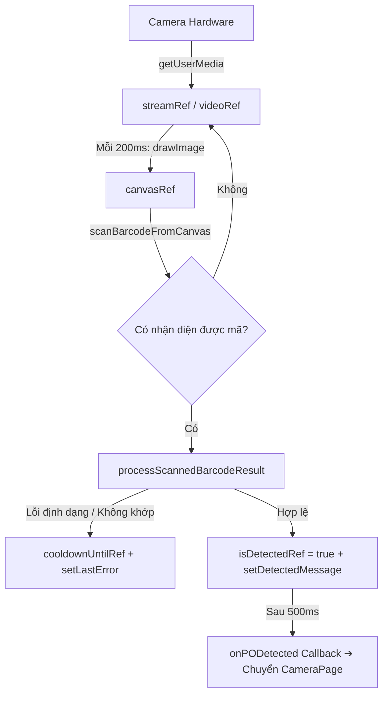

# Bảng Tra Cứu Chi Tiết: Toàn Bộ Biến, State, Ref & Function trong ScanPage & CameraPage

> Tài liệu này đóng vai trò như một **bản từ điển kỹ thuật và kiến trúc nội bộ**, giải thích chi tiết mục đích, kiểu dữ liệu, vị trí khai báo và tất cả các nơi sử dụng của từng biến, `useRef`, `useState`, biến phái sinh và hàm trong hai component:
> 1. [`ScanPage.tsx`](file:///d:/Workspace/ReactJS/DemoWithAI/src/pages/ScanPage.tsx) — Trang quét mã vạch và QR Code liên tục thời gian thực (Real-time Scanner).
> 2. [`CameraPage.tsx`](file:///d:/Workspace/ReactJS/DemoWithAI/src/pages/CameraPage.tsx) — Trang chụp ảnh đóng gói, quét mã trên ảnh, đối chiếu ảnh mẫu, điều khiển phần cứng camera và gửi API 2 bước.

---

## MỤC LỤC

1. [Phần 1: ScanPage.tsx](#1-phần-1-scanpagetsx)
   - [1.1. Props đầu vào (ScanPageProps)](#11-props-đầu-vào-scanpageprops)
   - [1.2. Các biến tham chiếu (useRef)](#12-các-biến-tham-chiếu-useref)
   - [1.3. Các biến trạng thái giao diện (useState)](#13-các-biến-trạng-thái-giao-diện-usestate)
   - [1.4. Biến phái sinh & Cục bộ](#14-biến-phái-sinh--cục-bộ)
   - [1.5. Các Functions & Callbacks](#15-các-functions--callbacks)
   - [1.6. Bảng tra cứu tổng hợp ScanPage](#16-bảng-tra-cứu-tổng-hợp-scanpage)
2. [Phần 2: CameraPage.tsx](#2-phần-2-camerapagetsx)
   - [2.1. Kiểu dữ liệu, Constants & Props](#21-kiểu-dữ-liệu-constants--props)
   - [2.2. Các biến tham chiếu phần cứng (useRef)](#22-các-biến-tham-chiếu-phần-cứng-useref)
   - [2.3. Các biến trạng thái điều khiển Camera & UI (useState)](#23-các-biến-trạng-thái-điều-khiển-camera--ui-usestate)
   - [2.4. Biến phái sinh & On-demand Loading](#24-biến-phái-sinh--on-demand-loading)
   - [2.5. Các Functions & Event Handlers](#25-các-functions--event-handlers)
   - [2.6. Bảng tra cứu tổng hợp CameraPage](#26-bảng-tra-cứu-tổng-hợp-camerapage)
3. [Phần 3: Luồng tương tác dữ liệu giữa App, ScanPage và CameraPage](#3-phần-3-luồng-tương-tác-dữ-liệu-giữa-app-scanpage-và-camerapage)

---

# 1. PHẦN 1: ScanPage.tsx

Tệp nguồn: [`src/pages/ScanPage.tsx`](file:///d:/Workspace/ReactJS/DemoWithAI/src/pages/ScanPage.tsx)  
Nhiệm vụ: Mở camera sau với độ phân giải cao, liên tục trích xuất frame hình chữ nhật mỗi 200ms vào canvas ẩn, gọi engine nhận diện cả Barcode 1D lẫn QR Code 2D. Khi bắt được mã hợp lệ đầu tiên, chuyển ngay sang `CameraPage`.

---

### 1.1. Props đầu vào (`ScanPageProps`)

| Tên Prop | Kiểu dữ liệu | Mục đích / Vai trò | Nơi được gọi / sử dụng |
| :--- | :--- | :--- | :--- |
| `onPODetected` | `(po: PhotoPackingSummary, codeMeta?: { format?: string; codeType?: "barcode" \| "qrcode" }) => void` | Callback kích hoạt khi quét thành công một mã PO hợp lệ (chuỗi 12 số hoặc barcode khớp dữ liệu). Nhận vào đối tượng đơn hàng và thông tin mã để [`App.tsx`](file:///d:/Workspace/ReactJS/DemoWithAI/src/App.tsx) chuyển sang `CameraPage`. | Gọi qua ref `onPODetectedRef.current` sau độ trễ 500ms hiển thị kết quả (dòng 161). |
| `onBack` | `() => void` | Callback khi người dùng bấm nút đóng (X) hoặc nút "Hủy quét" để quay về trang danh sách đơn hàng. | Được gọi bên trong hàm `handleClose()` (dòng 82). |

---

### 1.2. Các biến tham chiếu (`useRef`)

Khác với `useState`, các giá trị trong `useRef` khi thay đổi **không kích hoạt render lại UI**, rất thích hợp để quản lý luồng phần cứng và vòng lặp `setInterval`.

#### 1. `videoRef`
* **Kiểu dữ liệu:** `React.RefObject<HTMLVideoElement | null>`
* **Vị trí khai báo:** Dòng 23
* **Vai trò:** Tham chiếu trực tiếp đến thẻ `<video>` DOM trong JSX.
* **Nơi gán giá trị:**
  * Được gắn vào thẻ `<video ref={videoRef} />` (dòng 254).
  * Gán luồng camera: `videoRef.current.srcObject = stream` (dòng 107).
* **Nơi sử dụng:**
  * Kiểm tra video sẵn sàng frame: `video.readyState === video.HAVE_ENOUGH_DATA` (dòng 118).
  * Vẽ hình từ video sang canvas để quét: `ctx.drawImage(video, ...)` (dòng 128).
  * Dừng phát khi hủy: `videoRef.current.pause()`, `videoRef.current.srcObject = null` (dòng 63, 75).

#### 2. `canvasRef`
* **Kiểu dữ liệu:** `React.RefObject<HTMLCanvasElement | null>`
* **Vị trí khai báo:** Dòng 24
* **Vai trò:** Tham chiếu đến thẻ `<canvas className="hidden" />` trong JSX. Đóng vai trò làm "bộ nhớ đệm hình ảnh trung gian" (off-screen buffer) để chụp frame video và đưa vào thư viện quét mã.
* **Nơi gán giá trị:** Gắn vào thẻ `<canvas ref={canvasRef} className="hidden" />` (dòng 198).
* **Nơi sử dụng:**
  * Thiết lập kích thước trùng với video: `canvas.width = video.videoWidth`, `canvas.height = video.videoHeight` (dòng 123-124).
  * Lấy 2D context: `canvas.getContext("2d", { willReadFrequently: true })` (dòng 125).
  * Truyền vào engine quét: `scanBarcodeFromCanvas(canvas)` (dòng 131).

#### 3. `streamRef`
* **Kiểu dữ liệu:** `React.MutableRefObject<MediaStream | null>`
* **Vị trí khai báo:** Dòng 25
* **Vai trò:** Lưu trữ đối tượng `MediaStream` (luồng video nhận từ `navigator.mediaDevices.getUserMedia`) để có thể truy cập tức thì bất kỳ lúc nào cần giải phóng tài nguyên.
* **Nơi gán giá trị:** Gán khi camera khởi động thành công: `streamRef.current = stream` (dòng 105).
* **Nơi sử dụng:** Dùng trong `stopAll()` để duyệt qua tất cả track âm thanh/hình ảnh và gọi `track.stop()`, tắt hoàn toàn đèn camera phần cứng (dòng 52-59).

#### 4. `scanIntervalRef`
* **Kiểu dữ liệu:** `React.MutableRefObject<number | null>`
* **Vị trí khai báo:** Dòng 26
* **Vai trò:** Lưu ID của timer định kỳ `window.setInterval` (chu kỳ 200ms) để có thể hủy (`clearInterval`) khi component unmount hoặc khi đã phát hiện mã.
* **Nơi gán giá trị:** `scanIntervalRef.current = window.setInterval(...)` (dòng 112).
* **Nơi sử dụng:** Hủy timer trong `stopAll()`: `clearInterval(scanIntervalRef.current)` (dòng 49).

#### 5. `isDetectedRef`
* **Kiểu dữ liệu:** `React.MutableRefObject<boolean>`
* **Vị trí khai báo:** Dòng 27
* **Vai trò:** Cờ khóa (Mutex lock) đồng bộ tức thì. Khi mã quét hợp lệ được tìm thấy, cờ này đặt thành `true` ngay lập tức để ngăn các frame tiếp theo (vốn chạy mỗi 200ms) tiếp tục quét hay gọi `onPODetected` lặp lại.
* **Nơi gán giá trị:** Đặt thành `true` khi tìm thấy PO hợp lệ (dòng 153).
* **Nơi sử dụng:** Kiểm tra điều kiện đầu vòng lặp: `if (isDetectedRef.current) return` (dòng 113).

#### 6. `isProcessingFrameRef`
* **Kiểu dữ liệu:** `React.MutableRefObject<boolean>`
* **Vị trí khai báo:** Dòng 28
* **Vai trò:** Cờ ngăn chặn chồng chéo xử lý frame (Frame skipping). Nếu việc phân tích mã trên canvas của frame trước mất hơn 200ms, frame mới tiếp theo sẽ được bỏ qua cho đến khi frame trước chạy xong (`finally`).
* **Nơi gán giá trị:** Đặt `true` khi bắt đầu phân tích frame (dòng 120); đặt `false` trong khối `finally` (dòng 170).
* **Nơi sử dụng:** Kiểm tra đầu mỗi chu kỳ timer (dòng 113).

#### 7. `cooldownUntilRef`
* **Kiểu dữ liệu:** `React.MutableRefObject<number>`
* **Vị trí khai báo:** Dòng 29
* **Vai trò:** Lưu mốc thời gian timestamp (milliseconds). Khi quét phải mã không hợp lệ (ví dụ: QR không đủ 12 số), hệ thống đặt cooldown 2.5 giây (`Date.now() + 2500`) để không quét lại mã lỗi đó liên tục, giúp người dùng kịp đọc thông báo lỗi trên màn hình.
* **Nơi gán giá trị:** Gán `Date.now() + 2500` khi phát hiện mã không hợp lệ (dòng 146).
* **Nơi sử dụng:** Bỏ qua frame nếu `Date.now() < cooldownUntilRef.current` (dòng 135).

#### 8. `onPODetectedRef`
* **Kiểu dữ liệu:** `React.MutableRefObject<Function>`
* **Vị trí khai báo:** Dòng 30
* **Vai trò:** Kỹ thuật React Ref Pattern: giữ tham chiếu mới nhất của prop `onPODetected` mà không cần đưa `onPODetected` vào dependency array của `useEffect` (tránh khởi động lại camera khi prop re-render).
* **Nơi gán giá trị:** Cập nhật trong `useEffect` khi prop `onPODetected` thay đổi (dòng 39).
* **Nơi sử dụng:** Gọi callback báo PO thành công: `onPODetectedRef.current(po, ...)` (dòng 161).

---

### 1.3. Các biến trạng thái giao diện (`useState`)

| Tên State | Kiểu dữ liệu | Giá trị mặc định | Mục đích / Vai trò | Nơi cập nhật (`set...`) | Nơi sử dụng trong UI |
| :--- | :--- | :--- | :--- | :--- | :--- |
| `isDetected` | `boolean` | `false` | Đánh dấu đã nhận diện thành công mã PO hay chưa để kích hoạt giao diện thành công (ẩn laser quét). | `setIsDetected(true)` (dòng 154). | Ẩn laser quét khi đã nhận diện: `{!cameraError && !isDetected && ...}` (dòng 282). |
| `cameraError` | `string \| null` | `null` | Lưu thông báo lỗi nếu trình duyệt không cấp quyền camera hoặc không tìm thấy thiết bị phần cứng. | `setCameraError("Không thể mở camera...")` (dòng 175). | Hiển thị hộp thông báo lỗi và nút "Thử lại" thay thế khung video (dòng 238-251). |
| `detectedMessage`| `string \| null` | `null` | Chuỗi thông báo nhãn mã vừa bắt được (ví dụ: `Đã nhận diện [QR Code]: PO 8715`). | `setDetectedMessage(...)` (dòng 159). | Hiển thị văn bản hướng dẫn/kết quả ở footer (thông qua `scanStatus`, dòng 43, 295). |
| `lastError` | `string \| null` | `null` | Lưu chuỗi thông báo lỗi nghiệp vụ khi quét mã sai (ví dụ: QR không chứa PO 12 số hoặc barcode không tồn tại). | `setLastError(processed.errorMessage)` (dòng 144); tự xóa sau 3.5s (dòng 147). | Render popup Toast cảnh báo màu đỏ trôi nổi ở góc trên màn hình (dòng 228-233). |

---

### 1.4. Biến phái sinh & Cục bộ

* `scanStatus` (dòng 43-44): Chuỗi text hiển thị ở footer. Nếu có `detectedMessage` thì hiển thị kết quả, ngược lại hiển thị hướng dẫn mặc định: *"Hướng camera vào mã vạch Barcode hoặc QR Code..."*.
* `mounted` (dòng 87): Biến cờ boolean bên trong `useEffect` để ngăn gán state nếu component bị unmount trong lúc hàm `getUserMedia` đang chờ giải quyết (anti-leak).

---

### 1.5. Các Functions & Callbacks

#### 1. `stopAll()`
* **Kiểu:** `useCallback(() => void, [])`
* **Vị trí:** Dòng 47-78
* **Nhiệm vụ:** Hàm dọn dẹp triệt để:
  1. Hủy interval quét frame (`clearInterval`).
  2. Duyệt qua toàn bộ MediaStream tracks và gọi `.stop()` để tắt phần cứng camera.
  3. Dừng video và giải phóng thuộc tính `.srcObject`.
* **Nơi sử dụng:** Được gọi khi đóng trang (`handleClose`), khi unmount component (cleanup effect dòng 192), và khi cửa sổ trình duyệt đóng/reload (`beforeunload` dòng 185).

#### 2. `handleClose()`
* **Kiểu:** `useCallback(() => void, [stopAll, onBack])`
* **Vị trí:** Dòng 80-83
* **Nhiệm vụ:** Dừng toàn bộ camera (`stopAll()`) sau đó gọi callback `onBack()` để quay lại danh sách đơn hàng.
* **Nơi sử dụng:** Gắn vào nút Close (icon X) trên Header (dòng 219) và nút "Hủy quét" ở Footer (dòng 299).

#### 3. `init()` (bên trong `useEffect`)
* **Kiểu:** `async function`
* **Vị trí:** Dòng 89-180
* **Nhiệm vụ:**
  * Gọi `navigator.mediaDevices.getUserMedia` với cấu hình camera sau (`facingMode: "environment"`) độ phân giải Full HD (1080p).
  * Gán luồng vào `videoRef` và phát video.
  * Khởi tạo vòng lặp timer 200ms `scanIntervalRef`. Mỗi 200ms trích xuất frame từ video sang `canvasRef`, gọi `scanBarcodeFromCanvas(canvas)`.
  * Phân tích kết quả qua `processScannedBarcodeResult`. Nếu hợp lệ, gán `isDetectedRef = true`, hiện nhãn thông báo và sau 500ms gọi `onPODetectedRef.current(po, codeMeta)`.

---

### 1.6. Bảng tra cứu tổng hợp ScanPage



---

# 2. PHẦN 2: CameraPage.tsx

Tệp nguồn: [`src/pages/CameraPage.tsx`](file:///d:/Workspace/ReactJS/DemoWithAI/src/pages/CameraPage.tsx)  
Nhiệm vụ: Trang làm việc chính của quy trình đóng gói. Hỗ trợ đầy đủ tính năng chụp ảnh, kiểm soát phần cứng camera (zoom quang học, flash, độ sáng, độ phân giải), quét mã trên ảnh đã chụp, đối chiếu ảnh mẫu theo bước, gửi ảnh lên server (API 1), xác nhận hoàn tất bước (API 2) và cho phép chuyển tiếp liên tục sang bước kế tiếp mà không làm gián đoạn camera.

---

### 2.1. Kiểu dữ liệu, Constants & Props

#### `CameraFlowStep` (Dòng 38-45)
Quản lý trạng thái máy trạng thái hữu hạn (State Machine) của quy trình:
1. `"preview"`: Camera live, người dùng căn góc chụp.
2. `"scanning"`: Đã bấm chụp, đang chạy hiệu ứng laser phân tích mã trên ảnh (700ms).
3. `"confirm-po"`: Đã tìm thấy PO, mở [`ConfirmPODialog`](file:///d:/Workspace/ReactJS/DemoWithAI/src/components/ConfirmPODialog.tsx) đối chiếu ảnh chụp và ảnh mẫu.
4. `"uploading"`: Màn hình loading đang gửi ảnh lên server (API 1: `submitPhoto`).
5. `"result"`: Hiển thị [`PhotoResultDialog`](file:///d:/Workspace/ReactJS/DemoWithAI/src/components/PhotoResultDialog.tsx) kết quả gửi ảnh.
6. `"confirming"`: Màn hình loading đang gọi API 2: `confirmStep`.
7. `"done"`: Hoàn tất bước, hiển thị [`NotifyResultDialog`](file:///d:/Workspace/ReactJS/DemoWithAI/src/components/NotifyResultDialog.tsx) cho phép chụp tiếp bước sau hoặc tạm dừng.

#### `CameraPageProps` (Dòng 47-52)
* `targetOrder?: PhotoPackingSummary | null`: Đơn hàng được chọn từ trang danh sách ([`OrderListPage`](file:///d:/Workspace/ReactJS/DemoWithAI/src/pages/OrderListPage.tsx)).
* `scannedPO?: PhotoPackingSummary | null`: Đơn hàng được nhận diện từ trang quét mã ([`ScanPage`](file:///d:/Workspace/ReactJS/DemoWithAI/src/pages/ScanPage.tsx)).
* `scannedCodeMeta?: { format?: string; codeType?: "barcode" | "qrcode" } | null`: Metadata loại mã đã quét.
* `onBack: () => void`: Hàm điều hướng quay lại trang trước.

#### `RESOLUTION_CONFIG` (Dòng 56-63)
Từ điển cấu hình 3 mức độ phân giải:
* `"720p"`: 1280x720 (HD)
* `"1080p"`: 1920x1080 (Full HD - Mặc định)
* `"4k"`: 3840x2160 (Ultra HD)

---

### 2.2. Các biến tham chiếu phần cứng (`useRef`)

#### 1. `videoRef`
* **Kiểu:** `React.RefObject<HTMLVideoElement | null>` (Dòng 113)
* **Vai trò:** Trỏ tới phần tử `<video>` hiển thị hình ảnh thời gian thực từ camera.
* **Nơi dùng:** Gán `video.srcObject = stream` (dòng 237, 413, 590, 684), dùng kích thước `videoWidth`/`videoHeight` để chụp ảnh trong `handleCapture()` (dòng 485).

#### 2. `canvasRef`
* **Kiểu:** `React.RefObject<HTMLCanvasElement | null>` (Dòng 114)
* **Vai trò:** Thẻ `<canvas>` ẩn làm nền xử lý ảnh chụp: vẽ frame từ video, áp dụng độ sáng filter, crop phóng to zoom số, đóng dấu thời gian watermark ngày giờ và xuất ra chuỗi Base64 JPEG.
* **Nơi dùng:** Được gọi trong `handleCapture()` (dòng 481-552), `handleFileUpload()` (dòng 564-573).

#### 3. `fileInputRef`
* **Kiểu:** `React.RefObject<HTMLInputElement | null>` (Dòng 115)
* **Vai trò:** Trỏ tới thẻ `<input type="file" accept="image/*" />` ẩn để hỗ trợ tính năng phụ: tải ảnh từ thư viện thiết bị khi camera bị lỗi.
* **Nơi dùng:** Kích hoạt mở hộp thoại chọn file khi người dùng bấm nút: `fileInputRef.current?.click()` (dòng 921).

#### 4. `streamRef`
* **Kiểu:** `React.MutableRefObject<MediaStream | null>` (Dòng 116)
* **Vai trò:** Lưu trữ trực tiếp đối tượng `MediaStream` phần cứng để điều khiển torch (flash) và giải phóng triệt để các track khi tắt camera.
* **Nơi dùng:** Quản lý giải phóng track trong `startCamera()` (dòng 191-199), `stopCamera()` (dòng 258-274).

#### 5. `isCameraActiveRef`
* **Kiểu:** `React.MutableRefObject<boolean>` (Dòng 117)
* **Vai trò:** Cờ boolean bảo vệ tránh Race Condition. Khi chuyển trang nhanh, nếu `getUserMedia` trả về sau khi trang đã unmount, cờ này ngăn không cho gán stream vào component đã hủy.
* **Nơi dùng:** Đặt `true` khi mở camera (dòng 184, 393); đặt `false` khi dừng camera (dòng 254); kiểm tra điều kiện hủy (dòng 218, 240).

#### 6. `cameraRequestIdRef`
* **Kiểu:** `React.MutableRefObject<number>` (Dòng 118)
* **Vai trò:** Biến đếm số thứ tự yêu cầu mở camera. Mỗi lần đổi độ phân giải hoặc đổi camera trước/sau, ID này tăng lên 1 (`++cameraRequestIdRef.current`). Request nào có ID cũ hơn request mới nhất sẽ tự động bị hủy bỏ.
* **Nơi dùng:** Dòng 183, 218, 240, 255.

---

### 2.3. Các biến trạng thái điều khiển Camera & UI (`useState`)

| Tên State | Kiểu dữ liệu | Giá trị ban đầu | Mục đích kỹ thuật | Nơi sử dụng trong giao diện |
| :--- | :--- | :--- | :--- | :--- |
| `stream` | `MediaStream \| null` | `null` | Quản lý luồng video đang chạy để các hàm flash/zoom kiểm tra track video. | Dùng trong `toggleFlash`, `handleZoomChange`, `handleExposureChange`. |
| `facingMode` | `"environment" \| "user"` | `"environment"` | Hướng camera (sau hoặc trước). | Nút chuyển camera (dòng 866). |
| `capturedImage` | `string \| null` | `null` | Chuỗi Base64 của ảnh vừa chụp (có watermark ngày giờ). | Hiển thị ảnh xem trước và truyền vào Dialog xác nhận (dòng 1091, 1106). |
| `cameraError` | `string \| null` | `null` | Chuỗi thông báo lỗi khi không xin được quyền camera. | Hiển thị màn hình báo lỗi và nút tải ảnh thay thế (dòng 768). |
| `detectedCodeMeta` | `{ format?: string; codeType?: "barcode" \| "qrcode" } \| null` | `scannedCodeMeta` | Định dạng của mã đã quét được (ví dụ: Code 128, QR Code). | Hiển thị badge loại mã trong dialog xác nhận PO. |
| `isFlashOn` | `boolean` | `false` | Trạng thái đèn flash trợ sáng đang bật hay tắt. | Đổi màu icon tia sét trên header (dòng 689). |
| `hasTorchSupport` | `boolean` | `false` | Thiết bị/trình duyệt có hỗ trợ bật đèn Flash vật lý hay không. | Ẩn/hiện hoặc đổi tooltip nút Flash trên header. |
| `flashNotice` | `string \| null` | `null` | Thông báo tạm thời khi bấm flash trên thiết bị không hỗ trợ. | Toast cảnh báo màu vàng phía trên màn hình. |
| `zoom` | `number` | `1` | Mức phóng đại hiện tại (0.5x, 1x, 2x,...). | Thanh nút bấm chọn nhanh mức zoom (dòng 810). |
| `availableZoomLevels`| `number[]` | `[0.5, 1, 2]` | Danh sách các mức zoom khả dụng đọc được từ camera thiết bị. | Duyệt qua để render các nút tròn zoom (0.5x, 1x, 2x). |
| `supportsHardwareZoom`| `boolean` | `false` | Thiết bị có cảm biến zoom quang học/phần cứng hay chỉ zoom số. | Quyết định gọi lệnh phần cứng hay crop trên canvas. |
| `exposure` | `number` | `0` | Mức bù trừ phơi sáng/độ sáng (từ -2 đến +2). | Điều chỉnh độ sáng frame hình ảnh. |
| `showExposureControl`| `boolean` | `false` | Bật/tắt thanh trượt điều chỉnh độ sáng. | Hiển thị slider chỉnh độ sáng bên phải màn hình. |
| `resolution` | `ResolutionKey` | `"1080p"` | Độ phân giải của video preview (720p, 1080p, 4k). | Tiêu chuẩn chất lượng ảnh chụp. |
| `showResolutionMenu` | `boolean` | `false` | Bật/tắt menu dropdown chọn độ phân giải. | Menu lựa chọn độ phân giải ở góc trên. |
| `isSampleDialogOpen` | `boolean` | `false` | Mở modal xem phóng to ảnh mẫu đối chiếu đóng gói. | Modal chi tiết ảnh mẫu (dòng 1021). |
| `activeStepItem` | `PhotoPackingItem \| null` | `null` | Dữ liệu chi tiết của bước đóng gói hiện tại tải từ API on-demand. | Cung cấp URL ảnh mẫu và ghi chú kiểm tra bước. |
| `flowStep` | `CameraFlowStep` | `"preview"` | Bước hiện tại trong chu trình chụp ảnh (preview -> done). | Điều khiển hiển thị các dialog và trạng thái máy ảnh. |
| `detectedPO` | `PhotoPackingSummary \| null` | `scannedPO \|\| targetOrder` | Đối tượng thông tin đơn hàng hiện tại đang chụp. | Hiển thị số PO, tên hàng, tính toán bước tiếp theo. |
| `apiResult` | `SubmitPhotoResult \| null` | `null` | Kết quả trả về sau khi gọi API 1 (`submitPhoto`). | Truyền vào `PhotoResultDialog`. |
| `confirmResult` | `ConfirmStepResult \| null`| `null` | Kết quả trả về sau khi gọi API 2 (`confirmStep`). | Truyền vào `NotifyResultDialog` (chứa `hasNextStep`, `nextStepNumber`). |
| `scanErrorMessage` | `string \| null` | `null` | Thông báo lỗi khi ảnh chụp không tìm thấy mã hoặc mã sai. | Banner cảnh báo màu đỏ ở giữa màn hình camera. |

---

### 2.4. Biến phái sinh & On-demand Loading

#### 1. `samplePhotoUrl` (Dòng 136-142)
* **Vai trò:** Chuỗi URL ảnh mẫu đối chiếu. Sử dụng chuỗi ưu tiên (Fallback chain):
  `activeStepItem?.samplePhotoUrl` ➔ `detectedPO?.samplePhotoUrl` ➔ `targetOrder?.samplePhotoUrl` ➔ `scannedPO?.samplePhotoUrl` ➔ Ảnh mẫu chất lượng cao mặc định.

#### 2. Effect tải ảnh mẫu on-demand (Dòng 121-133)
* **Vai trò:** Mỗi khi `detectedPO` thay đổi (khi mở trang hoặc khi bấm chụp tiếp bước sau), effect tự tính toán:
  `const nextStep = currentPO.totalStep > 0 ? Math.min(currentPO.totalStep, currentPO.currentStep + 1) : currentPO.currentStep || 1`
  Sau đó gọi `fetchStepItemApi(currentPO.pO, nextStep)` để tải ảnh mẫu và ghi chú của bước đó về máy.

---

### 2.5. Các Functions & Event Handlers

#### Nhóm 1: Điều khiển phần cứng Camera
* **`inspectTrackCapabilities(track)`** (Dòng 144-175): Kiểm tra các tính năng phần cứng của `MediaStreamTrack`: kiểm tra đèn torch, dải zoom min/max, gán danh sách mốc zoom phù hợp.
* **`startCamera(mode, resKey)`** (Dòng 178-250): Khởi động camera phần cứng theo hướng quay và độ phân giải; giải phóng stream cũ; gắn video vào DOM; kích hoạt kiểm tra capabilities.
* **`stopCamera()`** (Dòng 253-297): Tắt flash, duyệt qua mọi tracks để `.stop()`, ngắt kết nối thẻ `<video>`, đưa state về trạng thái giải phóng hoàn toàn.
* **`handleClose()`** (Dòng 300-303): Gọi `stopCamera()` rồi thực thi `onBack()`.
* **`toggleCameraFacing()`** (Dòng 306-313): Đổi camera trước/sau, reset zoom về 1x, độ sáng về 0, tắt flash và khởi động lại luồng.
* **`toggleFlash()`** (Dòng 316-338): Bật/tắt đèn Flash vật lý qua `track.applyConstraints({ advanced: [{ torch }] })`.
* **`handleZoomChange(targetZoom)`** (Dòng 341-360): Áp dụng mức zoom phần cứng (nếu hỗ trợ) hoặc zoom kỹ thuật số.
* **`handleExposureChange(val)`** (Dòng 363-382): Điều chỉnh thanh phơi sáng `exposureCompensation` trên phần cứng.
* **`handleResolutionChange(newRes)`** (Dòng 385-389): Đổi độ phân giải (720p/1080p/4k) và khởi chạy lại camera.

#### Nhóm 2: Chụp ảnh & Xử lý mã trên ảnh
* **`handleCapture()`** (Dòng 478-553):
  1. Trích xuất frame từ video vào canvas.
  2. Áp dụng độ sáng & mức zoom số (nếu có).
  3. Đóng dấu thời gian watermark ở góc dưới bên phải theo định dạng `dd/MM/yyyy HH:mm`.
  4. Xuất ảnh ra Base64 JPEG (`setCapturedImage`).
  5. Gọi hàm `processScannedCode(canvas)`.
* **`handleFileUpload(e)`** (Dòng 556-577): Dự phòng cho trường hợp không dùng được camera, cho phép người dùng chọn ảnh từ thư viện máy để đưa vào quy trình.
* **`processScannedCode(canvas)`** (Dòng 418-475):
  * Chuyển trạng thái sang `"scanning"` (hiện hiệu ứng laser quét mã 700ms).
  * Gọi `scanBarcodeFromCanvas(canvas)` để tìm barcode/QR trên ảnh chụp.
  * Nếu tìm thấy: kiểm tra mã hợp lệ, gán `detectedPO` và chuyển sang `"confirm-po"`.
  * Nếu không tìm thấy mã trong ảnh: dùng lại `scannedPO` hoặc `targetOrder` đã chọn sẵn làm fallback để không làm gián đoạn công nhân.
* **`handleRetake()`** (Dòng 580-595): Hủy ảnh chụp hiện tại, xóa các kết quả lỗi, đưa máy về `"preview"` để chụp lại.

#### Nhóm 3: Tương tác API & Chuyển bước liên tục
* **`handleConfirmPO()`** (Dòng 598-623): Gọi **API Lần 1** (`submitPhoto`), gửi Base64 ảnh chụp và số bước `nextStep` lên hệ thống. Đưa sang `flowStep = "result"`.
* **`handleRetryUpload()`** (Dòng 692-694): Thử gửi lại ảnh khi API 1 bị gián đoạn mạng.
* **`handleConfirmResult()`** (Dòng 626-655): Gọi **API Lần 2** (`confirmStep`), xác nhận hoàn tất bước chụp sau khi đã so sánh ảnh chụp với ảnh mẫu. Đưa sang `flowStep = "done"`.
* **`handleContinueNextStep()`** (Dòng 658-690):
  * Được kích hoạt khi bấm nút **"Chụp tiếp bước X"** trong `NotifyResultDialog`.
  * Tính toán bước vừa xong, cập nhật `detectedPO.currentStep` lên bước tiếp theo.
  * Reset `capturedImage`, đưa `flowStep` về `"preview"`.
  * Luồng camera vẫn chạy ngầm nên màn hình chụp bước mới sẵn sàng **ngay lập tức (0ms delay)**, đồng thời `useEffect` tự động tải ảnh mẫu của bước mới.

---

### 2.6. Bảng tra cứu tổng hợp CameraPage

| Tên Hàm | Vị trí dòng | Trạng thái `flowStep` tác động | Mục đích chính |
| :--- | :--- | :--- | :--- |
| `startCamera()` | 178 | Bất kỳ | Mở luồng video camera từ phần cứng trình duyệt |
| `stopCamera()` | 253 | Bất kỳ | Tắt đèn camera, giải phóng tài nguyên phần cứng |
| `handleCapture()` | 478 | `preview` ➔ `scanning` | Chụp frame, đóng dấu ngày giờ watermark, quét mã |
| `processScannedCode()` | 418 | `scanning` ➔ `confirm-po` | Nhận diện mã vạch trên ảnh, kích hoạt dialog xác nhận |
| `handleRetake()` | 580 | Bất kỳ ➔ `preview` | Hủy ảnh hiện tại, chụp lại từ đầu |
| `handleConfirmPO()` | 598 | `confirm-po` ➔ `uploading` ➔ `result` | Gửi ảnh lên server lần 1 (`submitPhoto`) |
| `handleConfirmResult()`| 626 | `result` ➔ `confirming` ➔ `done` | Xác nhận hoàn thành bước lần 2 (`confirmStep`) |
| `handleContinueNextStep()`| 658 | `done` ➔ `preview` | Chuyển sang bước tiếp theo, giữ camera chạy liên tục |

---

# 3. PHẦN 3: Luồng tương tác dữ liệu giữa App, ScanPage và CameraPage

```
[OrderListPage]
      │
      ├─ Bấm vào đơn hàng cụ thể ──> App.tsx: handleOpenOrderCamera(order)
      │                                     │
      │                                     ▼ (targetOrder: PhotoPackingSummary)
      │                                [CameraPage]
      │                                     ▲ (scannedPO: PhotoPackingSummary)
      │                                     │
[ScanPage]                                  │
      │                                     │
      └─ Quét barcode/QR thành công ──> App.tsx: handlePODetected(po, codeMeta)
```

### Chu trình 7 bước (State Machine) bên trong CameraPage:

```
    [1. PREVIEW] ─────────(Bấm nút chụp: handleCapture)─────────┐
         ▲                                                      │
         │                                                      ▼
(Chụp tiếp: handleContinueNextStep)                        [2. SCANNING] (Hiệu ứng laser 700ms)
         │                                                      │
         │                                                      ▼
    [7. DONE]                                              [3. CONFIRM-PO]
   (NotifyResultDialog)                                   (ConfirmPODialog)
         ▲                                                      │
         │                                              (Bấm Xác nhận gửi)
(Bấm Xác nhận bước OK)                                          │
         │                                                      ▼
    [6. CONFIRMING] <──── [5. RESULT] <──── [4. UPLOADING] <────┘
   (Gọi confirmStep API) (PhotoResultDialog) (Gọi submitPhoto API)
```

> [!TIP]
> Tài liệu này được biên soạn bám sát cấu trúc mã nguồn thực tế của dự án. Khi thêm mới biến hoặc refactor hàm, vui lòng cập nhật lại tài liệu này để đảm bảo tính đồng bộ cho toàn bộ đội ngũ phát triển.
